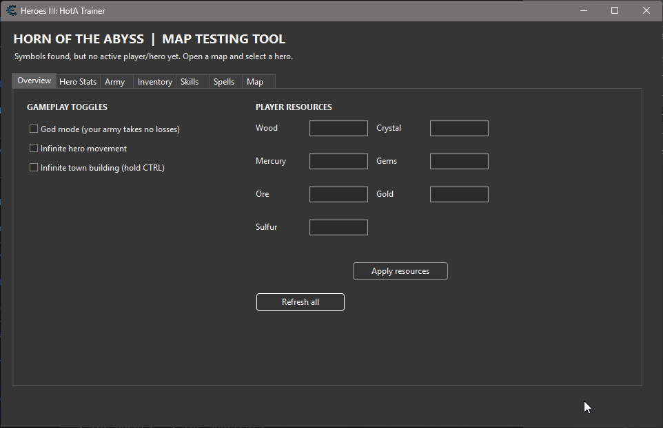

# HoMM3 HotA Cheat Table

`HOTA.CT` is the project's Cheat Engine table and includes the current trainer UI in its embedded Lua script. The separate `HotA_Trainer_UI.lua` file is outdated; use the Lua embedded in `HOTA.CT`.

The UI is organized into these categories:

## Overview

- Toggle god mode for the player's army.
- Toggle infinite hero movement.
- Toggle infinite town building while holding Ctrl.
- Edit the player's wood, mercury, ore, sulfur, crystal, gems, and gold.
- Refresh the displayed player and hero values.

## Hero Stats

- Read and edit the selected hero's experience, level, mana, attack, defence, spell power, knowledge, and movement points.
- Set the selected hero's mana to 9999.
- Read and edit hero specialty effect bytes. The displayed hero name and specialty description are not changed.

## Army

- Read and edit the creature type and count in each of the hero's seven army slots.
- Apply checks the edited values and reports write failures.

## Inventory

- Read and edit any of the 21 artifact records on the selected hero.
- Edit the paired value as a raw integer. This is not a full spellbook or inventory-effects editor.

## Skills

### Mastery

- Read and edit skill levels from Not learned through Expert.
- Choose whether to edit every skill or only skills the hero currently has.
- Quickly set skills to Expert while leaving Necromancy unchanged. The current-skill-only checkbox limits this preset to learned skills.
- Changes write the skill level bytes only; they do not edit skill order or learned-skill count.

### Memory Dump

- Dump the selected hero's skill area or full hero record for investigation.
- Read the HotA runtime skill-order array when the skill-order probe has captured its pointer.
- These dump controls are read-only.

## Spells

- Read and edit the selected hero's 140 spell-access flags.
- Load the table's reference spell set or clear all spell flags.
- Toggle repeated hero spell casts during combat and reset the captured cast flag manually. The game may refresh the spellbook after the next unit action.

## Map

- Capture a wandering neutral creature by right-clicking it with the probe enabled, then edit its count and disposition.
- Creature counts are limited to 1-4095; disposition ranges from 0 (always joins) to 10 (never joins).
- A puzzle-map reveal toggle is included, adapted from `HoMM3 2.0 HD.ct`. Its code signature has not been confirmed for the HotA executable and currently may fail to activate. The **Check puzzle patch** button reports whether the patch installed.
- Full map reveal is not yet implemented.

## Table files

- `HOTA.CT`: main HotA table and trainer UI.
- `h3hota HD.ct`: HotA reference table.
- `HoMM3 2.0 HD.ct`: HD Edition reference table; some addresses and code patches are for that executable and may not work in HotA.

The reference tables and code are discussed in the [Fearless Revolution thread](https://fearlessrevolution.com/viewtopic.php?f=4&t=13497). The main table targets the GOG Complete / HD Mod / HotA 1.8.1 setup; verify version-specific patches before using them.
